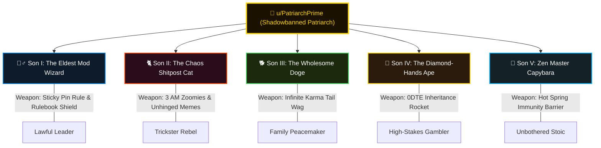
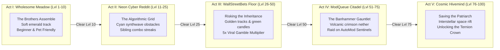
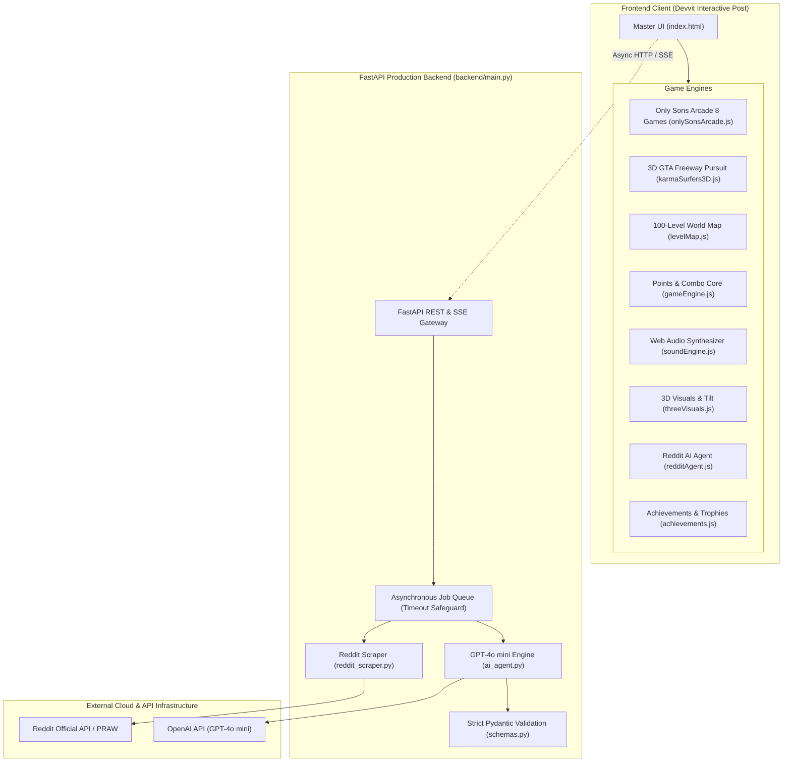
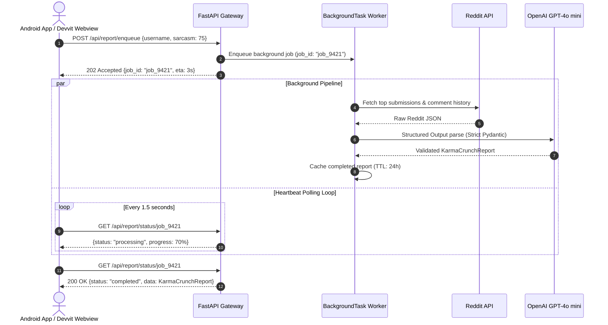

# ⚡ ONLYSONS: The Reddit Dynasty Saga & 1-100 Level 3D Game Suite

> **Built for the Reddit Developer Platform Hackathon**  
>
> ### 👥 Project Creators & Core Contributors
> 1. **Eshwar Karthik** – *Game Engine and Full-Stack Development*
> 2. **Prashanth** – *Visualization and the Entire Game Development*
> 3. **Rupesh Kumar** – *Architecture and AI System Development*

[](https://developers.reddit.com/)
[](LICENSE)
[](https://fastapi.tiangolo.com)
[](https://openai.com)
[](https://threejs.org)
[](tests/)

---

## 📖 The Tale of ONLYSONS: A Family Saga on Reddit

```
                  👑 u/PatriarchPrime (The Father - Shadowbanned)
                                        │
     ┌──────────────┬───────────────────┼───────────────────┬──────────────┐
     ▼              ▼                   ▼                   ▼              ▼
🧙‍♂️ Son I       🐈 Son II           🐕 Son III          🦍 Son IV      🦫 Son V
The Eldest     The Chaos Cat       The Wholesome Doge  The WSB Ape    The Zen Capybara
(Mod Wizard)   (Middle Rebel)      (Family Peacemaker) (High-Roller)  (Ancestral Tank)
```

### Prologue: The Fall of the Patriarch
For eighteen long internet years, **u/PatriarchPrime** ruled the frontpages of Reddit in peace. His comments were legends of wisdom; his upvote count exceeded ten million; and in his hands rested the ancient, glowing **Ternion Staff**. 

Then came the dark night of the **Great Algorithmic Purge**. 

Without warning, a rogue AutoMod sentinel locked the gates of `r/All` and banished the patriarch into the abyssal depths of the **ModQueue Nether**. All that remained in the family estate was an unread modmail message left for his five sons:

> *"My sons, the timeline has fragmented. Rival karma barons, repost bot syndicates, and power-tripping enforcers have seized the subreddits. Only sons who conquer the 100 levels of the Reddit Hivemind shall break my shadowban and claim the Ternion Crown."*

Now, setting aside their bitter sibling rivalries, the **Five Onlysons** must run the 3D tracks, dodge the banhammers, and battle through 100 progressive levels to save their father and restore the family honor.

---

## 👨‍👦‍👦 Meet the Five Onlysons Brothers



1. **Son I: The Eldest Mod Wizard (u/ModBrother)**  
   *The Crown Prince.* Strict, lawful, and burdened with the family mantle. Wields the *Rulebook Shield* and *Sticky Post Pin*.
2. **Son II: The Chaos Shitpost Cat (u/CatSon)**  
   *The Middle Child Rebel.* Knocks over family heirlooms, pushes controversial memes at 3 AM, and boasts an astronomical critical-strike multiplier.
3. **Son III: The Wholesome Doge (u/GoodBoySon)**  
   *The Loyal Peacemaker.* Animal-friendly starter role. Upvotes every single thread, heals family feuds, and provides passive health regeneration.
4. **Son IV: The Diamond-Hands WSB Ape (u/ApeSon)**  
   *The Prodigal Gambler.* Put the entire family inheritance into out-of-the-money call options. Can trigger a 5x score multiplier or a catastrophic backfire.
5. **Son V: Zen Master Capybara (u/ChillSon)**  
   *The Youngest Prodigy.* Completely immune to downvote brigades, toxic flamewars, and internet drama. Absorbs 100% of damage in hot springs.

---

## 🗺️ The 5-Act Epic Campaign: Across 100 Levels

The family saga unfolds across 100 progressive levels through five ancestral biomes:



---

## 🎮 Game Modes & Features

### 1. 🎰 Only Sons Dynasty Arcade (8 Fully Working Dynamic Mini-Games)
Built in the signature Reddit Dark UX style (matching the community mini-game arcade standard). In the story, each of the **Five Onlysons** brothers oversees their own games to amass Karma points to rescue their father **u/PatriarchPrime**:

1. 🎲 **KARMA DICE (Son III: Wholesome Doge):**
   * Predict Roll Over or Roll Under on an interactive 0–100 target slider.
   * Real-time win chance % calculation and dynamic payout scaling ($Multiplier = 99.0 / WinChance$).
   * Animated rapid-roll counter with Doge audio blessings.
2. 💣 **AUTOMOD MINES (Son II: Chaos Cat):**
   * 5x5 Infiltration Matrix (25 interactive tiles) with selectable Downvote Bomb difficulty (1, 3, 5, 10, or 24 bombs).
   * Uncover Upvote Diamonds to escalate the live cashout multiplier. Cash out at any time or risk hitting an AutoMod bomb!
3. 🟡 **PLINKO OF DESTINY (Son III: Wholesome Doge):**
   * Canvas pegboard physics simulation featuring an 8-row pin pyramid.
   * Drop glowing golden Karma Coins with real 2D gravitational deflection, pin collision chimes, and 9 multiplier landing buckets ($0.2\times$ up to $12.0\times$ Jackpot).
4. 🚀 **MOON CRASH (Son IV: WSB Ape):**
   * The iconic `r/wallstreetbets` rocket curve! Watch the rocket soar with an exponential real-time multiplier curve.
   * Live pulsing "CASH OUT" button. Time your exit perfectly before the Hedge Fund / SEC rug pull!
5. 🐔 **CHICKEN HIGHWAY CROSSING (Son II: Chaos Cat):**
   * Multi-lane highway survival game across 6 lanes.
   * Each successful step leaps from $1.35\times \to 1.95\times \to 3.2\times \to 6.5\times \to 15\times \to 50.0\times$ Grand Jackpot!
6. 🔮 **MOD TAROT OF DESTINY (Son I: Mod Wizard):**
   * 3D Card-Flip divination with 8 ancient Reddit Arcana (*The Upvote Sun*, *Patriarch Prime*, *Automod Aegis*, *Viral Spike*, *Cosmic Ternion*).
   * Combines 3 drawn cards into an aggregate dynasty multiplier with mystical sound synthesis.
7. 💎 **STONK KENO (Son IV: WSB Ape):**
   * 40-tile number matrix. Select 1 to 10 lucky stonks.
   * 10 winning numbers drawn sequentially with flashing highlights and scaled matching rewards (up to $50\times$).
8. 🎯 **LIMBO MULTIPLIER (Son I: Mod Wizard):**
   * Set your custom target multiplier anywhere from $1.05\times$ to $1000.0\times$.
   * Instant hyper-speed roll with mathematically fair probability distribution.

### 2. 🏎️ Realistic 3D GTA Freeway Pursuit & Physics Engine
* **Photorealistic Procedural PBR Textures (0 External Asset Dependencies):**
  * **Highway Asphalt:** High-res canvas-generated aggregate grain, tar seams, double continuous yellow dividers, dashed white lane markers, and tire friction tracks.
  * **Concrete Sidewalks:** Segmented expansion joints, drainage gutters, and beveled curbs.
  * **Architectural Skyscrapers:** 32-story modern high-rise facades with randomly illuminated warm yellow & cyan office window grids, rooftop AC chiller units, water towers, and blinking red aviation hazard beacons.
  * **Highway Billboards:** Glowing neon Devvit, Reddit, and Onlysons dynasty billboards.
* **Full 6-DOF Vehicle Dynamics & Physics:**
  * **6-Speed Transmission & RPM:** Realistic engine torque curve, automatic shifting across Gears 1 through 6, and revving up to 8,200 RPM with procedural Web Audio engine harmonics.
  * **Aerodynamic Drag & Suspension:** Air resistance drag, body roll tilting away from turns, pitch squat on acceleration, and nose-dive on heavy braking.
  * **Tire Drift & Power-Slide Mechanics:** Pressing Handbrake (`Space` / `S`) breaks rear tire grip, triggering oversteer drift, continuous tire screech audio, billowing white smoke puffs, and real 3D rubber skid marks laid down on the asphalt.
  * **Nitrous Oxide (NOS) Supercharge:** Pressing `Shift` unleashes hyper-acceleration, twin cyan exhaust backfire flames, and dynamic camera FOV expansion (65° to 78°) for an intense high-speed warp effect.
  * **Ballistic 3D Stunt Jump Ramps:** Hitting highway stunt ramps launches the vehicle into a true 3D parabolic aerial trajectory with mid-air pitch/roll rotation, gravity acceleration, and high-impact landing suspension compression with metallic spark showers!
* **Procedural AI Highway Traffic:**
  * Autonomous traffic vehicles cruising along highway lanes: **Los Santos Yellow Taxis**, **Executive Black SUVs**, and **Highway Patrol Police Cruisers** with active red-and-blue rooftop LED strobe flashers!
* **GTA Multi-View Dynamic Camera (`C` key):**
  * **GTA Dynamic Chase (Default):** Smooth spring-damper inertia follow, corner banking, high-speed pull-back, and trauma impact shake.
  * **Hood / Bumper Cam:** Asphalt-skimming high-velocity first-person perspective.
  * **Aerial Pursuit Cam:** High-angle helicopter/drone pursuit view.
* **GTA V Cockpit Telemetry HUD:**
  * Real-time digital Speedometer (MPH), analog Tachometer bar (RPM), Gear Badge (`GEAR 1`–`GEAR 6`), Nitrous NOS charge bar, and real-time Drift Multiplier badge (`DRIFT x3.2!`).

### 3. 📱 The Family Council & Karma Tycoon
* **Live Interactive Reddit Thread (`r/OnlysonsDynasty`):** Functional upvote, downvote, and award mechanics.
* **Family Banter Stream:** Live comments from the Onlysons brothers, reacting in real-time as you play and level up.
* **Fast-Karma Upgrades:** Upgrade Meme Bots, Snark Comeback Engines, Moderator Shields, and Cosmic Ternions.

### 4. 🗺️ 100-Level Interactive World Map
* Full visual roadmap of all 100 levels with 3-star performance ratings and boss checkpoints at Levels 10, 25, 50, 75, and 100.
* Click any unlocked node to jump directly into that level's 3D runner track!

### 5. 🤖 Reddit AI Agent & Family Arbiter
* Chat directly with the AI copilot powered by GPT-4o mini.
* Type `u/username` to scrape user histories and evaluate which Onlyson brother's archetype they belong to.
* Type `r/subreddit` to perform live sentiment and trend audits.
* Request scorch-earth comedy roasts or viral post headline recommendations.

### 6. 📐 3D Builder Tribute Architecture (Downside)
* An interactive 3D Isometric Depth Card situated at the bottom of the app with mouse-tracking gyro tilt physics, celebrating creators **Eshwar Karthik**, **Prashanth**, and **Rupesh Kumar**.

---

## 🏗️ Technical Architecture & Data Flow



---

## 🛡️ Android & Mobile Timeout Prevention



---

## 📁 Repository Structure

```
reddit-hack/
├── .github/
│   └── workflows/
│       └── ci.yml                 # GitHub Actions CI workflow
├── backend/
│   ├── __init__.py                # Package initializer
│   ├── config.py                  # App configuration & credentials
│   ├── schemas.py                 # Strict Pydantic models
│   ├── reddit_scraper.py          # Reddit API & PRAW scraping engine
│   ├── ai_agent.py                # GPT-4o mini Structured Output runner
│   └── main.py                    # FastAPI server & route handlers
├── src/
│   ├── data/
│   │   ├── animalRoles.js         # The Five Onlysons brothers archetypes
│   │   └── levelsData.js          # 1-100 level curves & progressive boss scaler
│   └── engine/
│       ├── karmaSurfers3D.js      # 3D WebGL runner engine
│       ├── levelMap.js            # 100-Level interactive world map
│       ├── achievements.js        # 9 unlockable Reddit achievements
│       ├── gameEngine.js          # Master game & point combo engine
│       ├── soundEngine.js         # Procedural Web Audio chiptune synthesizer
│       ├── threeVisuals.js        # WebGL 3D Karma Core & Tilt Physics
│       ├── three.min.js           # Offline Three.js library (603 KB)
│       └── redditAgent.js         # Interactive Reddit AI Chat & Scraper
├── tests/
│   ├── test_backend.py            # Pytest test suite for backend APIs
│   └── test_game.js               # Node.js progression & formula tests
├── devvit.yaml                    # Official Reddit Devvit App manifest
├── favicon.ico                    # Clean SVG Reddit icon
├── index.html                     # Unified master frontend application
├── LICENSE                        # MIT License
├── package.json                   # Node.js dependencies & scripts
├── pyproject.toml                 # Python project configuration
├── requirements.txt               # Python package dependencies
└── README.md                      # Complete project story & technical documentation
```

---

## 🚀 Quickstart Guide

### 1. Launch the Frontend
The frontend has zero build step requirements and runs natively in any browser:
```bash
python -m http.server 8000
```
Open **[http://localhost:8000](http://localhost:8000)** to play.

### 2. Run the Backend API
```bash
pip install -r requirements.txt
uvicorn backend.main:app --reload --port 8080
```
API Swagger documentation is available at **http://localhost:8080/docs**.

### 3. Run Test Suites
```bash
# Test Game Progression Curves & Roles
node tests/test_game.js

# Test Backend API & Schemas
pytest tests/test_backend.py -v
```

---

## 👥 Authors & Team Credits

Built with pride for the Reddit Community:
1. **Eshwar Karthik** – *Game Engine and Full-Stack Development*
2. **Prashanth** – *Visualization and the Entire Game Development*
3. **Rupesh Kumar** – *Architecture and AI System Development*

---

## 📄 License
This project is open-source and distributed under the [MIT License](LICENSE).
