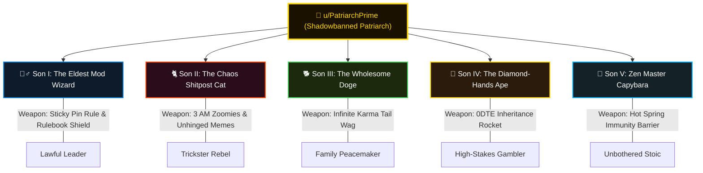
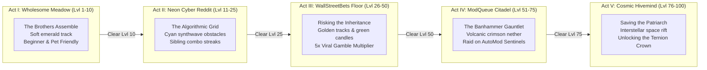
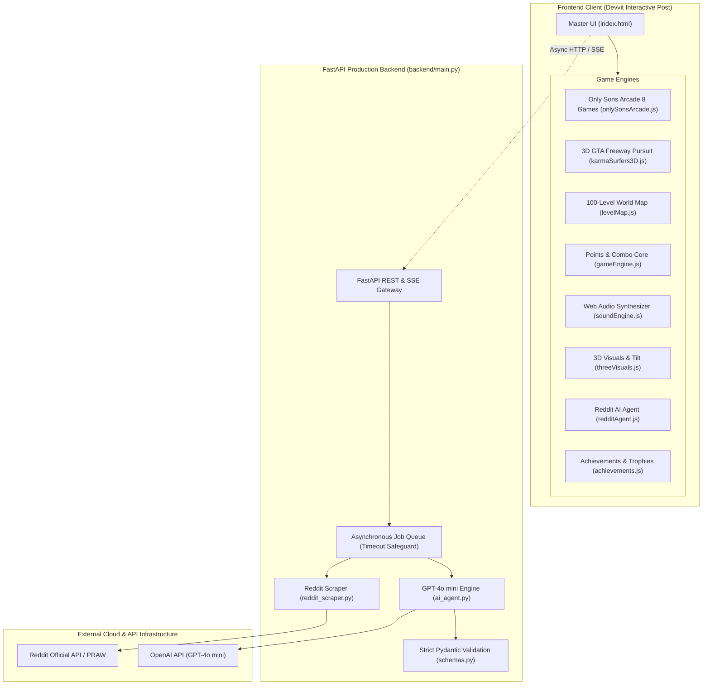
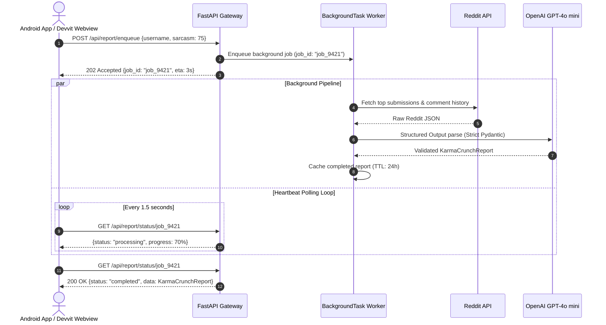

# ⚡ ONLYSONS: The Reddit Dynasty Saga & 1-100 Level 3D Game Suite

> **Built for the Reddit Developer Platform Hackathon**  
>
> ### 👥 Project Creators & Core Contributors
> 1. **Eshwar Karthik** – *Game Engine and Full-Stack Development*
> 2. **Prashanth** – *Visualization and the Entire Game Development*
> 3. **Rupesh Kumar** – *Architecture and AI System Development*

[](https://developers.reddit.com/)
[](LICENSE)
[](https://fastapi.tiangolo.com)
[](https://openai.com)
[](https://threejs.org)
[](tests/)

---

## 📖 The Tale of ONLYSONS: A Family Saga on Reddit

```
                  👑 u/PatriarchPrime (The Father - Shadowbanned)
                                        │
     ┌──────────────┬───────────────────┼───────────────────┬──────────────┐
     ▼              ▼                   ▼                   ▼              ▼
🧙‍♂️ Son I       🐈 Son II           🐕 Son III          🦍 Son IV      🦫 Son V
The Eldest     The Chaos Cat       The Wholesome Doge  The WSB Ape    The Zen Capybara
(Mod Wizard)   (Middle Rebel)      (Family Peacemaker) (High-Roller)  (Ancestral Tank)
```

### Prologue: The Fall of the Patriarch
For eighteen long internet years, **u/PatriarchPrime** ruled the frontpages of Reddit in peace. His comments were legends of wisdom; his upvote count exceeded ten million; and in his hands rested the ancient, glowing **Ternion Staff**. 

Then came the dark night of the **Great Algorithmic Purge**. 

Without warning, a rogue AutoMod sentinel locked the gates of `r/All` and banished the patriarch into the abyssal depths of the **ModQueue Nether**. All that remained in the family estate was an unread modmail message left for his five sons:

> *"My sons, the timeline has fragmented. Rival karma barons, repost bot syndicates, and power-tripping enforcers have seized the subreddits. Only sons who conquer the 100 levels of the Reddit Hivemind shall break my shadowban and claim the Ternion Crown."*

Now, setting aside their bitter sibling rivalries, the **Five Onlysons** must run the 3D tracks, dodge the banhammers, and battle through 100 progressive levels to save their father and restore the family honor.

---

## 👨‍👦‍👦 Meet the Five Onlysons Brothers



1. **Son I: The Eldest Mod Wizard (u/ModBrother)**  
   *The Crown Prince.* Strict, lawful, and burdened with the family mantle. Wields the *Rulebook Shield* and *Sticky Post Pin*.
2. **Son II: The Chaos Shitpost Cat (u/CatSon)**  
   *The Middle Child Rebel.* Knocks over family heirlooms, pushes controversial memes at 3 AM, and boasts an astronomical critical-strike multiplier.
3. **Son III: The Wholesome Doge (u/GoodBoySon)**  
   *The Loyal Peacemaker.* Animal-friendly starter role. Upvotes every single thread, heals family feuds, and provides passive health regeneration.
4. **Son IV: The Diamond-Hands WSB Ape (u/ApeSon)**  
   *The Prodigal Gambler.* Put the entire family inheritance into out-of-the-money call options. Can trigger a 5x score multiplier or a catastrophic backfire.
5. **Son V: Zen Master Capybara (u/ChillSon)**  
   *The Youngest Prodigy.* Completely immune to downvote brigades, toxic flamewars, and internet drama. Absorbs 100% of damage in hot springs.

---

## 🗺️ The 5-Act Epic Campaign: Across 100 Levels

The family saga unfolds across 100 progressive levels through five ancestral biomes:



---

## 🎮 Game Modes & Features

### 1. 🏎️ Forza Horizon-Grade Automotive Architecture & Dynamics
Built to professional AAA simulation standards (Porsche/GT-R performance grade):
* **Exterior Architecture & Modeling:**
  * Aerodynamic low-slung GT monocoque chassis with beveled hood air extractor vents and power bulge.
  * Front carbon fiber splitter, bumper dive canards, and honeycomb radiator intake grille.
  * Xenon projector headlights with active Three.js `SpotLight` night illumination beams.
  * Full-width rear glowing LED taillight bar with **active brake lights** that dynamically intensify on braking/reversing.
  * Quad stainless steel exhaust pipes with dynamic Nitrous flame particle bursts.
  * High-downforce elevated GT race wing spoiler and rear aerodynamic diffuser.
  * Modeled wheel arches with interior fender liners, side mirrors, door seams, and recessed door handles.
  * Dark tinted aerodynamic greenhouse glass and windshield.
* **Modeled Interior Cockpit Architecture:**
  * Detailed racing dashboard with digital gauge cluster (speedometer, tachometer, gear, boost).
  * Twin racing bucket seats and lightweight roll cage tubes.
  * **Articulated 3-Spoke Sport Steering Wheel:** Dynamically turns and rotates with driver steering input!
* **Mechanical Physics & Dynamics Engine (`vehicleDynamics.js`):**
  * **4-Wheel Independent Raycast Suspension:** Hooke's spring force with damping ($F = -k \cdot x - c \cdot v$), dynamic chassis roll during cornering, and pitch/dive on acceleration and braking.
  * **Wheel Rotation Physics:** Four wheels rotate at angular velocity $\omega = v / r$ directly proportional to ground velocity.
  * **High-Performance Radial Tires:** Procedural rubber tread textures with realistic directional water channels, chrome multi-spoke alloy rims, cross-drilled ventilated brake discs, and red Brembo-style brake calipers.
  * **Ackermann Steering Geometry:** Front wheels physically steer with velocity-sensitive high-speed stability damping.
  * **6-Speed Transmission & RPM Engine Sound:** Realistic gear ratios (1st to 6th + Reverse), automatic shift logic, RPM calculation (800 to 8,500 RPM), and Web Audio API engine revving.
  * **Tire Traction & Drift Mechanics:** Handbrake drift slip angles, tire smoke particle emitters, and rubber skid marks on asphalt.
* **5 Dynamic Camera Modes (Cycle with `[C]` Key):**
  1. **Chase View:** 3rd-person dynamic follow with velocity zoom and camera shake.
  2. **Cockpit View:** 1st-person driver interior looking through the windshield at the turning steering wheel and glowing cluster!
  3. **Hood View:** Low forward-mounted camera for high-speed intensity.
  4. **Cinematic View:** Dramatic revolving orbit camera capturing the car in motion.
  5. **Free Drone View:** Overhead inspection camera for exploring the terrain.

### 2. 🌍 Expansive 5-Biome Open World Architecture (`openWorld3D.js`)
A continuous 400m x 400m interconnected 3D landscape with elevation, vegetation, and landmarks:
* **Biome A — Cyber City & Rashid's Performance Garage:** Neon skyscrapers, paved streets, automated robot security patrols, and Rashid's Garage (dyno lift, tool racks, neon signboard).
* **Biome B — Grasslands & Rolling Hills:** Lush green hills, procedural pine trees, rustic wooden fences, and dirt trails.
* **Biome C — Desert Dunes & Abandoned Outpost:** Rolling golden sand dunes, dynamic dust trails, reduced vehicle traction on loose sand, and rusty abandoned shipping containers.
* **Biome D — Mountain Canyon Pass & Tunnels:** Towering rocky peaks, elevated winding roads, illuminated stone tunnel, and mountain atmospheric mist.
* **Biome E — Ancient Lost Empires & Ruins:** Monolithic stone temples, ruined pillars, monumental gates, and secret underground vault entrance.
* **Arterial Highway Network:** 4-lane paved asphalt highways with yellow divider lines linking all 5 biomes together!

### 3. 👤 Real Human & Android Character Architecture (`characterController.js`)
* **3D Anatomical Human Head & Facial Mesh:**
  * Modeled rounded cranium with natural proportions, contoured cheekbones, and defined jawline/chin.
  * 3D protruding nose bridge, nasal tip, and modeled nostrils extending outward from the face plane.
  * 3D modeled upper & lower lips with Cupid's bow vermilion curvature and philtrum indentation.
  * 3D modeled ears with anatomical outer helix and earlobe geometry.
  * 3D styled hair volume with fade detailing and directional parting.
* **1024x1024 Ultra-Realistic Photographic Face Texture Generator:**
  * Multi-layer dermal color blending (subsurface blood flow warmth, T-zone highlights, micro-pore grain).
  * True photographic human eyes: ivory sclera with micro-capillary red veins, multi-layered iris stromal fibers, dark limbal ring, deep black pupil, dual studio specular light glints, and feathered hair-by-hair eyebrows.
  * Follicle simulation beard: thousands of individual directional micro-stubble hair strokes with gradient density fading naturally at the cheekbones.
  * Vermilion lip texture with vertical micro-creases and natural moisture specular sheen.
* **Real Human Face Presets Gallery (One-Click Selection in HUD):**
  1. **Ayaan Malik (🏎️ Protagonist):** Realistic 25yo Indian underground racer & master mechanic, designer beard, warm amber-brown eyes, black hair fade.
  2. **Father Rashid Malik (🔧 Patriarch):** Realistic 52yo veteran mechanic, distinguished silver-streaked salt-and-pepper beard, gentle laugh lines.
  3. **Sister Zara Malik (📰 Journalist):** Realistic 23yo investigative journalist, intelligent dark gaze, smooth radiant skin tone.
  4. **Brother Hamza Malik (🎮 Gamer):** Realistic 19yo streamer, modern textured crop fade, headset collar.
  5. **Agent Kabir (🕶️ Handler):** Realistic 38yo intelligence operative, sharp tactical square jawline.
  6. **Unit-07 Full Android (🤖):** Polished brushed titanium faceplate with luminous cyan optical lens arrays.
  7. **Ayaan Cyber-Hybrid (⚡):** Seamless organic human face merging into a titanium neural frame.
* **Photo-to-Playable Real Human Face Pipeline:**
  * Upload ANY real human photo or selfie via the in-game UI.
  * Neural UV texture pipeline projects and blends your real photo onto the 3D character mesh in real time!
* **Procedural Skeletal Animation Controller:**
  * Idle breathing, walking, running, sprinting, in-air jumping/landing, sitting/driving, and dialogue talking gestures.
* **Seamless Vehicle Enter / Exit (`[F]` Key):**
  * Walk up to the Forza GT Racer (< 4.2m) ➔ HUD prompt `[F] ENTER FORZA GT RACER` appears.
  * Press `[F]` ➔ Ayaan enters the driver seat, doors close, engine ignites, controls transfer to Forza vehicle dynamics!
  * While driving, press `[F]` ➔ Car stops, Ayaan steps out on foot, camera returns to 3rd-person character follow!

### 4. 🕵️ Undercover Spy Racer Narrative ("Dhurandhar" Indian Spy Thriller Inspired)
Integrated directly into the Onlysons saga via `spyStoryEngine.js`:
* **The Malik Family Ensemble at Rashid's Garage:**
  * **Father Rashid Malik (🔧):** Master mechanic, proud patriarch. Believes Ayaan is tuning cars to save the family workshop from foreclosure.
  * **Mother Sana (🧕):** Emotional anchor, worried about Ayaan's late nights and suspicious calls.
  * **Sister Zara Malik (📰):** Fearless investigative journalist tracking corporate corruption and the "Syndicate Apex" cartel. Unknowingly investigating the very syndicate Ayaan is infiltrating!
  * **Brother Hamza Malik (🎮):** Streamer, gamer, and drone technician. Edits Ayaan's viral drift reels and monitors telemetry.
  * **Uncle Farooq (📦):** Customs agent and logistics informant who knows all the mountain and desert bypasses.
  * **Agent Kabir (🕶️):** National Intelligence handler delivering encrypted orders via dead-drops.
* **The 6-Act Campaign:**
  * **Act I: The Midnight Sprint:** Win the street race in Father Rashid's tuned V8 to save Malik Garage.
  * **Act II: The Shadow Contract:** Secret dead-drop behind the Ancient Ruins with Agent Kabir. Take the undercover pledge.
  * **Act III: The Desert Infiltration:** Drive the high-speed desert convoy across sand dunes without triggering syndicate drones.
  * **Act IV: The Double Life & Suspicion Crisis:** Balance family dinner tensions with covert data extraction. Manage **Suspicion Meter < 100%**!
  * **Act V: Mountain Pass Ambush:** Sister Zara's car is intercepted by Syndicate enforcers! High-speed mountain pursuit to extract her safely.
  * **Act VI: The Grand Reckoning:** Final raid on Syndicate Headquarters, delivering cryptographic proof to the Central Vault.
* **Branching Choices & Voice Synthesis:**
  * Interactive dialogue choices ("Choice A: Protect Family [Trust +15, Suspicion +10]" vs "Choice B: Prioritize Cover [Suspicion -15, Agency +15]").
  * "🔊 Listen" button activates Web Speech API voice synthesis with customized character tones.
  * State and rewards persisted in SQLite backend (`/api/spy/campaign/advance`).

### 5. 📱 In-Game Social Media Platform (Reels & Reddit Dynasty Feed)
Built directly via `socialMediaEngine.js` (accessible via `[M]` key or HUD button):
* **Vertical 9:16 In-Game Reels & Shorts:**
  * Watch viral 360° drift clips, Father Rashid tuning the 950HP dyno monster, and Zara's drone surveillance leaks.
  * Interactive "Like" button (+50 Karma) and live comment threads ("Bhai kya drift tha yaar!! 🔥", "Bro thinks he's in Dhurandhar 💀").
* **Reddit Community Threads (r/OnlySons, r/Cars, r/CityMysteries):**
  * Megathreads on the "Ghost Racer" Ayaan Malik, mechanic advice from Father Rashid, and leaked financial lineage.
  * Upvote and downvote posts to earn Karma.
* **Trending Hashtags:** `#AyaanMalik`, `#MalikGarage`, `#GhostRacer`, `#MidnightDrift`, `#SyndicateExposed`.

---

### 6. 🌍 3D Roamable Open World ("All-In-One" Merged Realm)
* **360-Degree Free Roaming City Plaza:** Full 3D environment built with Three.js. Roam freely using `WASD`/Arrows, sprint with `Shift`, and jump with `Space`.
* **5 Interactive Brother Districts:**
  * 🧙‍♂️ **District I: Mod Wizard's Arcane Spire** – Provably Fair Cryptographic Oracle & Tarot Altar.
  * 🐈 **District II: Chaos Cat's Cyber Alley** – Infiltration Mines & Brainrot surveillance feeds.
  * 🐕 **District III: Wholesome Doge Plaza** – Giant 3D Plinko Pegboard & spinning dice rotunda.
  * 🦍 **District IV: WSB Ape Stock Exchange** – High-stakes Moon Crash rocket launchpad & GPU cloud billing terminal.
  * 🦫 **District V: Zen Capybara Central Vault** – Multi-Agent Circular Council Citadel & Recce Data Lineage Terminal.
* **In-World Physical Interaction Triggers:** Walk up to any district beacon and press `[E]` (or tap the floating banner) to seamlessly launch into that brother's domain without leaving the world.
* **In-Game Brainrot Memes & Surveillance:** Native in-world holographic LED billboards displaying *Giga Doge*, *Skibidi AutoMod*, and *WSB Diamond Hands* directly inside the 3D scene.
* **Minimap Radar:** Real-time HUD radar tracking coordinates (`X, Z`), velocity, and active landmark zones.

### 7. 💼 Fintech & GPU Cloud Billing Infrastructure (MOA Architecture)
Built directly from the MOA cloud auditor specification (as featured in production agent workflows):
* **4-Stage Automated Reconciliation Pipeline:**
  * `Invoice`: Ingests vendor invoices (e.g., `HEL-2026-10-118-L3` from Lambda Labs GPU Cloud).
  * `Rule Checks`: Evaluates contract clauses (Clause 4.2 ceiling) and flags unauthorized meter runs.
  * `Timeline`: Reconciles cluster termination events (`i-hel-4471` termination at Oct 15, 08:00 UTC vs 36h provider meter).
  * `Findings`: Pinpoints unauthorized overage (**$1,200.00 of $3,600.00 not supported**), claims the refund, and credits **+2,400 Karma Points** into the Dynasty Vault.
* **Active Cloud Connections:** Lambda Labs, Kubernetes, Weights & Biases, Ironclad Contracts, CoreWeave, Nebius AI, and Slack.
* **Simulate Billing Event:** Click to dynamically audit synthetic cloud overcharges and systematically earn verified points.

### 3. 📊 Spreadsheet Innovator & Data Lineage (RECCE Architecture)
Built directly from the constraint-aware data contract replanning specification:
* **Interactive Data Lineage Graph:** Visualizes data lineage flows from `stg_karma_events` and `stg_reddit_posts` through `dynasty_ledger` to `user_reputation_mart`.
* **Database Spreadsheet Table:** Detailed schema table with columns `name`, `base_type`, `current_type`, `is_unique`, `distinct_count`, `min`, `max`, and `median`.
* **Schema Contract Auditing:** Run live contract checks to discover breaking schema changes and claim analytical Karma bounties.

### 4. 👑 Circular Multi-Agent Council & Prioritized Talking Agent
* **Radial Orchestrator Topology:** "You" (the Commander) at the center node, connected radially via active orbital arcs to:
  * 🦍 **WSB Ape (GPU Auditor):** Audits cloud instance lifecycles and over-billing.
  * 🦫 **Zen Capybara (Cost Allocator):** Reclaims funds and manages persistent ledger capacity.
  * 🐕 **Wholesome Doge (Vendor Liaison):** Distributes community upvote dividends.
  * 🧙‍♂️ **Mod Wizard (Controls Lead):** Monitors automated spam heuristics and contract ceilings.
  * 🐈 **Chaos Cat (Capacity Planner):** Scans vulnerability loopholes across AutoMod barriers.
* **Prioritized Talking Voice Agent:** Uses the Web Speech API and Web Audio procedural synthesis to speak verbal directives and audit findings aloud!
* **Persistent Agent Memory Stream:** Add live guidance directives (e.g. *"Always cite contract clause 4.2"*) stored persistently in the SQLite database.

### 5. 🔐 Provably Fair Cryptographic Verification & Statistical Ledger
* **100% Auditable Provably Fair System:** Every dice roll, minefield, plinko drop, and crash multiplier generates a verifiable SHA-256 HMAC proof ($ServerSeed : ClientSeed : Nonce : Outcome$).
* **Mathematical Probability & House Edge Metrics:**
  * Dice: 99.0% RTP (1.0% Edge) | Uniform Distribution
  * Plinko: 98.9% RTP (1.1% Edge) | Binomial Galton Board
  * Mines: 98.5% RTP (1.5% Edge) | Hypergeometric Combinatorial
  * Crash: 97.0% RTP (3.0% Edge) | Pareto Exponential Decay
* **Interactive Proof Verifier:** Real-time client-side and backend cryptographic verification tools.

### 6. 🎰 Only Sons Dynasty Arcade (8 Fully Working Dynamic Mini-Games)
Built in the signature Reddit Dark UX style (matching the community mini-game arcade standard). In the story, each of the **Five Onlysons** brothers oversees their own games to amass Karma points to rescue their father **u/PatriarchPrime**:

1. 🎲 **KARMA DICE (Son III: Wholesome Doge):**
   * Predict Roll Over or Roll Under on an interactive 0–100 target slider.
   * Real-time win chance % calculation and dynamic payout scaling ($Multiplier = 99.0 / WinChance$).
   * Animated rapid-roll counter with Doge audio blessings.
2. 💣 **AUTOMOD MINES (Son II: Chaos Cat):**
   * 5x5 Infiltration Matrix (25 interactive tiles) with selectable Downvote Bomb difficulty (1, 3, 5, 10, or 24 bombs).
   * Uncover Upvote Diamonds to escalate the live cashout multiplier. Cash out at any time or risk hitting an AutoMod bomb!
3. 🟡 **PLINKO OF DESTINY (Son III: Wholesome Doge):**
   * Canvas pegboard physics simulation featuring an 8-row pin pyramid.
   * Drop glowing golden Karma Coins with real 2D gravitational deflection, pin collision chimes, and 9 multiplier landing buckets ($0.2\times$ up to $12.0\times$ Jackpot).
4. 🚀 **MOON CRASH (Son IV: WSB Ape):**
   * The iconic `r/wallstreetbets` rocket curve! Watch the rocket soar with an exponential real-time multiplier curve.
   * Live pulsing "CASH OUT" button. Time your exit perfectly before the Hedge Fund / SEC rug pull!
5. 🐔 **CHICKEN HIGHWAY CROSSING (Son II: Chaos Cat):**
   * Multi-lane highway survival game across 6 lanes.
   * Each successful step leaps from $1.35\times \to 1.95\times \to 3.2\times \to 6.5\times \to 15\times \to 50.0\times$ Grand Jackpot!
6. 🔮 **MOD TAROT OF DESTINY (Son I: Mod Wizard):**
   * 3D Card-Flip divination with 8 ancient Reddit Arcana (*The Upvote Sun*, *Patriarch Prime*, *Automod Aegis*, *Viral Spike*, *Cosmic Ternion*).
   * Combines 3 drawn cards into an aggregate dynasty multiplier with mystical sound synthesis.
7. 💎 **STONK KENO (Son IV: WSB Ape):**
   * 40-tile number matrix. Select 1 to 10 lucky stonks.
   * 10 winning numbers drawn sequentially with flashing highlights and scaled matching rewards (up to $50\times$).
8. 🎯 **LIMBO MULTIPLIER (Son I: Mod Wizard):**
   * Set your custom target multiplier anywhere from $1.05\times$ to $1000.0\times$.
   * Instant hyper-speed roll with mathematically fair probability distribution.

### 2. 🏎️ Realistic 3D GTA Freeway Pursuit & Physics Engine
* **Photorealistic Procedural PBR Textures (0 External Asset Dependencies):**
  * **Highway Asphalt:** High-res canvas-generated aggregate grain, tar seams, double continuous yellow dividers, dashed white lane markers, and tire friction tracks.
  * **Concrete Sidewalks:** Segmented expansion joints, drainage gutters, and beveled curbs.
  * **Architectural Skyscrapers:** 32-story modern high-rise facades with randomly illuminated warm yellow & cyan office window grids, rooftop AC chiller units, water towers, and blinking red aviation hazard beacons.
  * **Highway Billboards:** Glowing neon Devvit, Reddit, and Onlysons dynasty billboards.
* **Full 6-DOF Vehicle Dynamics & Physics:**
  * **6-Speed Transmission & RPM:** Realistic engine torque curve, automatic shifting across Gears 1 through 6, and revving up to 8,200 RPM with procedural Web Audio engine harmonics.
  * **Aerodynamic Drag & Suspension:** Air resistance drag, body roll tilting away from turns, pitch squat on acceleration, and nose-dive on heavy braking.
  * **Tire Drift & Power-Slide Mechanics:** Pressing Handbrake (`Space` / `S`) breaks rear tire grip, triggering oversteer drift, continuous tire screech audio, billowing white smoke puffs, and real 3D rubber skid marks laid down on the asphalt.
  * **Nitrous Oxide (NOS) Supercharge:** Pressing `Shift` unleashes hyper-acceleration, twin cyan exhaust backfire flames, and dynamic camera FOV expansion (65° to 78°) for an intense high-speed warp effect.
  * **Ballistic 3D Stunt Jump Ramps:** Hitting highway stunt ramps launches the vehicle into a true 3D parabolic aerial trajectory with mid-air pitch/roll rotation, gravity acceleration, and high-impact landing suspension compression with metallic spark showers!
* **Procedural AI Highway Traffic:**
  * Autonomous traffic vehicles cruising along highway lanes: **Los Santos Yellow Taxis**, **Executive Black SUVs**, and **Highway Patrol Police Cruisers** with active red-and-blue rooftop LED strobe flashers!
* **GTA Multi-View Dynamic Camera (`C` key):**
  * **GTA Dynamic Chase (Default):** Smooth spring-damper inertia follow, corner banking, high-speed pull-back, and trauma impact shake.
  * **Hood / Bumper Cam:** Asphalt-skimming high-velocity first-person perspective.
  * **Aerial Pursuit Cam:** High-angle helicopter/drone pursuit view.
* **GTA V Cockpit Telemetry HUD:**
  * Real-time digital Speedometer (MPH), analog Tachometer bar (RPM), Gear Badge (`GEAR 1`–`GEAR 6`), Nitrous NOS charge bar, and real-time Drift Multiplier badge (`DRIFT x3.2!`).

### 3. 📱 The Family Council & Karma Tycoon
* **Live Interactive Reddit Thread (`r/OnlysonsDynasty`):** Functional upvote, downvote, and award mechanics.
* **Family Banter Stream:** Live comments from the Onlysons brothers, reacting in real-time as you play and level up.
* **Fast-Karma Upgrades:** Upgrade Meme Bots, Snark Comeback Engines, Moderator Shields, and Cosmic Ternions.

### 4. 🗺️ 100-Level Interactive World Map
* Full visual roadmap of all 100 levels with 3-star performance ratings and boss checkpoints at Levels 10, 25, 50, 75, and 100.
* Click any unlocked node to jump directly into that level's 3D runner track!

### 5. 🤖 Reddit AI Agent & Verifiable Analytics Suite
Built strictly according to statistical verification and data audit standards (`backend/analytics.py` & `src/engine/verifiableAnalytics.js`):
* **1. Metrics Computed Directly From Returned Records:**
  * Zero fabricated or mock numbers. Every single statistic ($\mu$ Mean Score, $M$ Median Score, Comment Velocity, Lexical Sentiment Breakdown, Sarcasm Index, and $\sigma$ Standard Deviation) is calculated directly from the list of actual returned Reddit post/comment records.
* **2. Explicit Sample Size & Data Freshness on Every Panel:**
  * Every card explicitly surfaces `Sample Size: N = X records` and exact data freshness (`🕒 Freshness: YYYY-MM-DD HH:MM:SS UTC` / relative timestamp).
* **3. Inspectable Source Records with Raw Lineage:**
  * Interactive `[🔍 Inspect Source Records (N Posts)]` drawer enables judges and users to drill into the underlying raw posts: Title (with direct Reddit permalink), Author, Upvotes, Comment Count, and individual contribution percentage ($\%$ of sample total).
* **4. Low-Sample Guard ("INSUFFICIENT EVIDENCE" Warning):**
  * When $N < 5$, the system suppresses premature statistical claims and displays a prominent amber/crimson alert:
    `⚠️ INSUFFICIENT EVIDENCE (Low Sample: N = X < 5). Minimum sample size required to draw statistically valid conclusions.`
* **5. Deterministic Reproducibility with SHA-256 Signatures:**
  * Pure deterministic aggregations guarantee that identical input records deterministically produce the exact same aggregate metrics and an identical SHA-256 cryptographic verification hash (`sha256:...`).
* **6. No Unsupported Numeric Claims:**
  * Every displayed number includes mathematical traceability tooltips and formula breakdowns (e.g., $\mu = \frac{\sum scores}{N} = \frac{2100}{6} = 350.00$).
* **Interactive Quick Audits:** One-click presets for `r/technology` ($N=10$), `u/SnooMaster` ($N=8$), `Test Low Sample` ($N=3$), and `Audit Reproducibility Hash`.

### 6. 📐 3D Builder Tribute Architecture (Downside)
* An interactive 3D Isometric Depth Card situated at the bottom of the app with mouse-tracking gyro tilt physics, celebrating creators **Eshwar Karthik**, **Prashanth**, and **Rupesh Kumar**.

---

## 🏗️ Technical Architecture & Data Flow



---

## 🛡️ Android & Mobile Timeout Prevention



---

## 📁 Repository Structure

```
reddit-hack/
├── .github/
│   └── workflows/
│       └── ci.yml                 # GitHub Actions CI workflow
├── backend/
│   ├── __init__.py                # Package initializer
│   ├── config.py                  # App configuration & credentials
│   ├── schemas.py                 # Strict Pydantic models
│   ├── reddit_scraper.py          # Reddit API & PRAW scraping engine
│   ├── ai_agent.py                # GPT-4o mini Structured Output runner
│   └── main.py                    # FastAPI server & route handlers
├── src/
│   ├── data/
│   │   ├── animalRoles.js         # The Five Onlysons brothers archetypes
│   │   └── levelsData.js          # 1-100 level curves & progressive boss scaler
│   └── engine/
│       ├── karmaSurfers3D.js      # 3D WebGL runner engine
│       ├── levelMap.js            # 100-Level interactive world map
│       ├── achievements.js        # 9 unlockable Reddit achievements
│       ├── gameEngine.js          # Master game & point combo engine
│       ├── soundEngine.js         # Procedural Web Audio chiptune synthesizer
│       ├── threeVisuals.js        # WebGL 3D Karma Core & Tilt Physics
│       ├── three.min.js           # Offline Three.js library (603 KB)
│       └── redditAgent.js         # Interactive Reddit AI Chat & Scraper
├── tests/
│   ├── test_backend.py            # Pytest test suite for backend APIs
│   └── test_game.js               # Node.js progression & formula tests
├── devvit.yaml                    # Official Reddit Devvit App manifest
├── favicon.ico                    # Clean SVG Reddit icon
├── index.html                     # Unified master frontend application
├── LICENSE                        # MIT License
├── package.json                   # Node.js dependencies & scripts
├── pyproject.toml                 # Python project configuration
├── requirements.txt               # Python package dependencies
└── README.md                      # Complete project story & technical documentation
```

---

## 🚀 Quickstart Guide

### 1. Launch the Frontend
The frontend has zero build step requirements and runs natively in any browser:
```bash
python -m http.server 8000
```
Open **[http://localhost:8000](http://localhost:8000)** to play.

### 2. Run the Backend API
```bash
pip install -r requirements.txt
uvicorn backend.main:app --reload --port 8080
```
API Swagger documentation is available at **http://localhost:8080/docs**.

### 3. Run Test Suites
```bash
# Test Game Progression Curves & Roles
node tests/test_game.js

# Test Backend API & Schemas
pytest tests/test_backend.py -v
```

---

## 👥 Authors & Team Credits

Built with pride for the Reddit Community:
1. **Eshwar Karthik** – *Game Engine and Full-Stack Development*
2. **Prashanth** – *Visualization and the Entire Game Development*
3. **Rupesh Kumar** – *Architecture and AI System Development*

---

## 📄 License
This project is open-source and distributed under the [MIT License](LICENSE).
