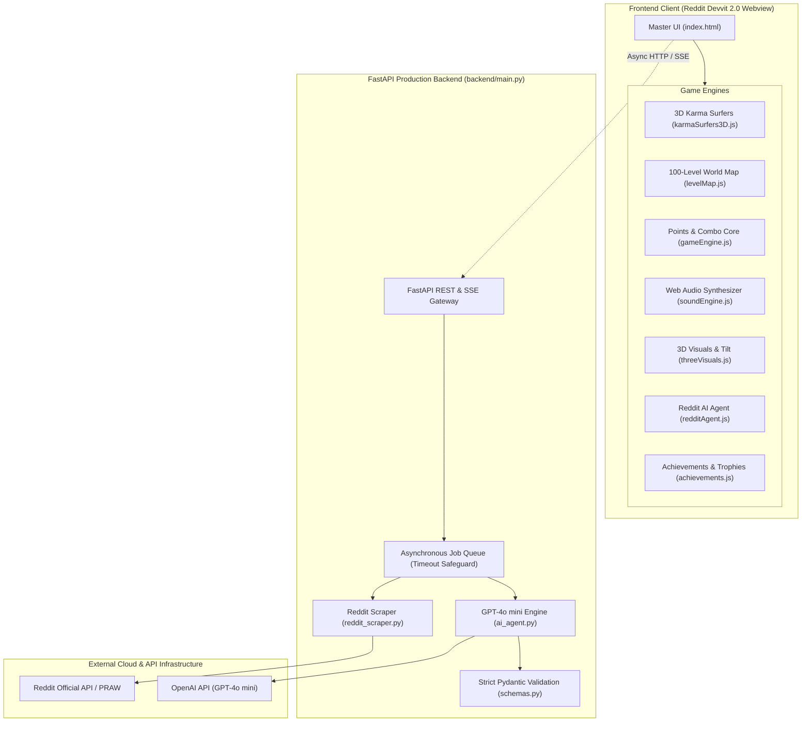
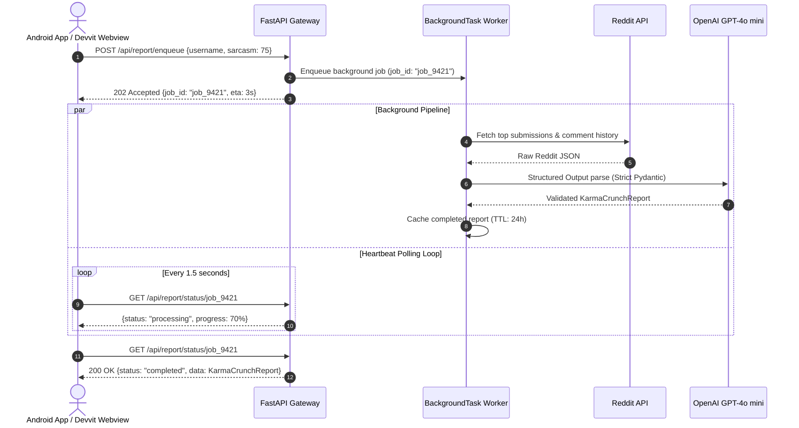
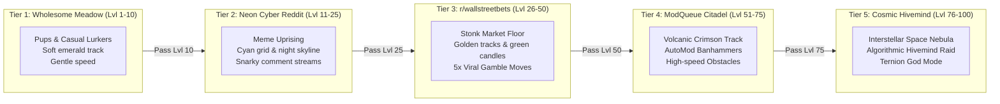
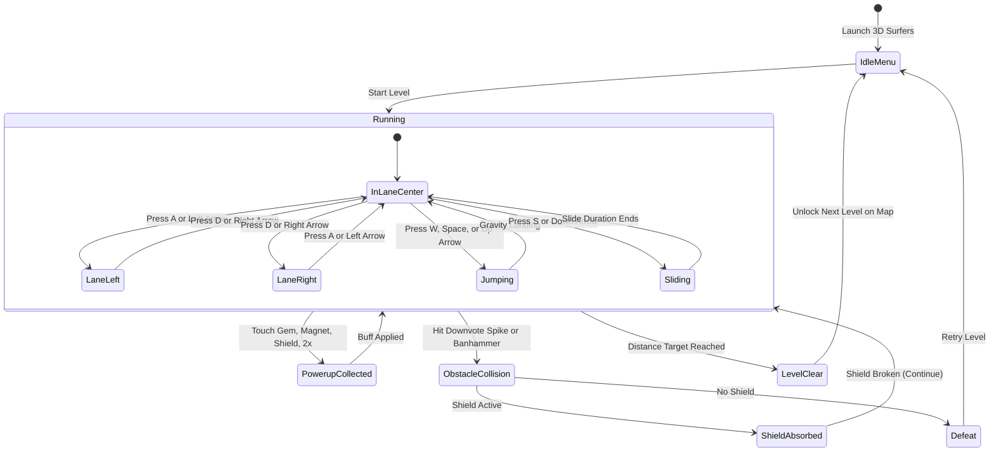

# ⚡ ONLYSONS: 1-100 Level Reddit Community Game & AI Suite

> **Built for the Reddit Developer Platform Hackathon**  
>
> ### 👥 Project Creators & Core Contributors
> 1. **eshwar Karthik** – *Game Engine and Full-Stack Development*
> 2.  **Prashanth** – *Visualization and the Entire Game Development*
> 2. **Rupesh Kumar** – *Architecture and AI System Development*

[](https://developers.reddit.com/)
[](LICENSE)
[](https://fastapi.tiangolo.com)
[](https://openai.com)
[](https://threejs.org)
[](tests/)

---

## 🌟 Executive Summary

**KarmaCrunch** is an AI-powered Reddit community game and profiling suite that transforms any Reddit account into an interactive, 100-level RPG experience. Engineered as an authentic **Devvit interactive post application**, it integrates live Reddit scraping, token-level constrained GPT-4o mini structured outputs, and a 3D isometric architecture.

---

## 📊 System Architecture & Data Flow

### 1. High-Level System Architecture


---

### 2. Android & Mobile Timeout Prevention Sequence
Mobile networks (OkHttp, Android webviews, and Devvit) terminate requests with `SocketTimeoutException` if operations exceed 10–15s. KarmaCrunch solves this with a two-phase async queue:



---

### 3. 100-Level Progression & Procedural Biomes Flow
The game scales dynamically across 5 progressive brackets up to Level 100:



---

### 4. 3D Karma Surfers Real-Time Gameplay State Machine


---

### 5. OpenAI Structured Outputs & AI Dossier Pipeline


---

## 🏆 Key Features

### 1. 3D Karma Surfers (WebGL Three.js Endless & Level Runner)
* **Full 3D WebGL Camera & Physics:** 3-lane runner with smooth lane switching, jumping over Downvote Spikes, and sliding under AutoMod Banhammers.
* **Procedural Biomes across Levels 1-100:**
  * **Levels 1–10 (Wholesome Meadow):** Soft emerald track, gentle speed for pups and beginner players.
  * **Levels 11–25 (Neon Cyber Reddit):** Cyan wireframes and synthwave neon obstacles.
  * **Levels 26–50 (r/wallstreetbets Floor):** Golden tracks with floating green candle charts and high-speed multipliers.
  * **Levels 51–75 (ModQueue Fortress):** Volcanic crimson track with rotating banhammers.
  * **Levels 76–100 (Cosmic Hivemind):** Interstellar space rift and warp speed obstacles.
* **Power-Ups:** 🧲 *Karma Magnet*, ⚡ *2x Multiplier*, and 🛡️ *AutoMod Shield*.
* **100-Level World Map:** Interactive visual progression map with star ratings for all 100 levels.

### 2. Animal & Player Roles
* 🐕 **Wholesome Doge:** High health, passive healing, and loyal upvotes.
* 🐈 **Chaos Shitpost Cat:** High critical strike rate with chaotic 3 AM Zoomies.
* 🦫 **Zen Capybara:** Maximum defense against internet downvotes and toxic flamewars.
* 🦍 **Diamond-Hands Ape:** r/wallstreetbets high-roller with 5x viral gamble moves.
* 🧙‍♂️ **Cosmic Reddit Wizard:** Master of Reddit Gold and the Ternion All-Powerful relic.

### 3. 🤖 Reddit AI Agent Chat & Scraper
* Type `u/username` to scrape real Reddit user dossiers and calculate karma velocity.
* Type `r/subreddit` to perform live sentiment and trend audits.
* Request scorch-earth comedy roasts or viral post headline recommendations.

### 4. 📐 3D Interactive Builder Tribute Architecture
* At the bottom of the interface lies a responsive **3D Isometric Depth Card** featuring WebGL particle core rendering and mouse-tracking gyro tilt physics, celebrating creators **Rupesh Kumar**, **Eshwar Kartik**, and **Prashant**.

### 5. 🔊 Web Audio API Procedural Synthesizer
* Zero external audio files or mp3 dependencies! Generates procedural 8-bit chiptune sound effects in real-time.

---

## 📁 Repository Structure

```
reddit-hack/
├── .github/
│   └── workflows/
│       └── ci.yml                 # GitHub Actions CI workflow
├── backend/
│   ├── __init__.py                # Package initializer
│   ├── config.py                  # App configuration & credentials
│   ├── schemas.py                 # Strict Pydantic models
│   ├── reddit_scraper.py          # Reddit API & PRAW scraping engine
│   ├── ai_agent.py                # GPT-4o mini Structured Output runner
│   └── main.py                    # FastAPI server & route handlers
├── src/
│   ├── data/
│   │   ├── animalRoles.js         # Playable animal & Redditor archetypes
│   │   └── levelsData.js          # 1-100 level curve & boss generator
│   └── engine/
│       ├── karmaSurfers3D.js      # 3D WebGL runner engine
│       ├── levelMap.js            # 100-Level interactive world map
│       ├── achievements.js        # 9 unlockable Reddit achievements
│       ├── gameEngine.js          # Master game & point combo engine
│       ├── soundEngine.js         # Procedural Web Audio chiptune synthesizer
│       ├── threeVisuals.js        # WebGL 3D Karma Core & Tilt Physics
│       ├── three.min.js           # Offline Three.js library
│       └── redditAgent.js         # Interactive Reddit AI Chat & Scraper
├── tests/
│   ├── test_backend.py            # Pytest test suite for backend APIs
│   └── test_game.js               # Node.js progression & formula tests
├── devvit.yaml                    # Official Reddit Devvit App manifest
├── index.html                     # Unified master frontend application
├── LICENSE                        # MIT License
├── package.json                   # Node.js dependencies & scripts
├── pyproject.toml                 # Python project configuration
├── requirements.txt               # Python package dependencies
└── README.md                      # Complete project documentation
```

---

## 🚀 Quickstart Guide

### 1. Launch the Frontend
The frontend has zero build step requirements and runs natively in any browser:
```bash
python -m http.server 8000
```
Open **[http://localhost:8000](http://localhost:8000)** to play.

### 2. Run the Backend API
```bash
pip install -r requirements.txt
uvicorn backend.main:app --reload --port 8080
```
API Swagger documentation is available at **http://localhost:8080/docs**.

### 3. Run Test Suites
```bash
# Test Game Progression Curves & Roles
node tests/test_game.js

# Test Backend API & Schemas
pytest tests/test_backend.py -v
```

---

## 👥 Authors & Team Credits

Built with pride for the Reddit Community:
1. **Prashant** – *Visualization and the entire game development*
2. **Rishir Kartik** – *Game engine and full-stack development*
3. **Rupesh Kumar** – *Architecture and AI system development with system-level deep integration*

---

## 📄 License
This project is open-source and distributed under the [MIT License](LICENSE).
